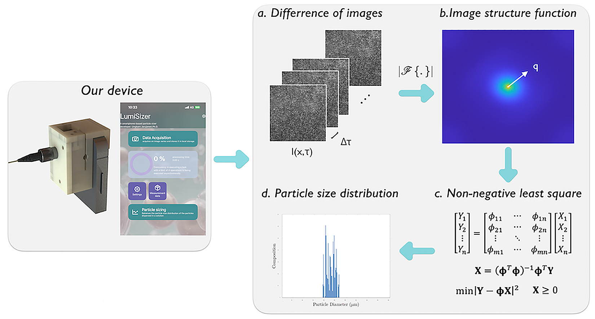
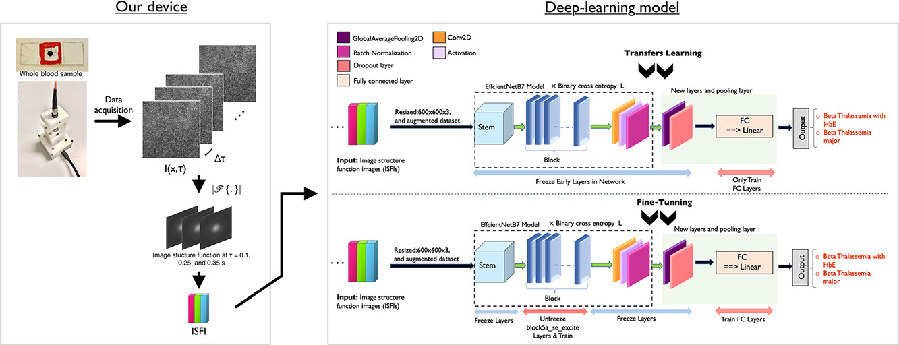
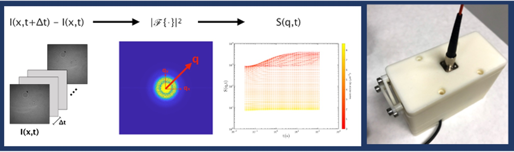
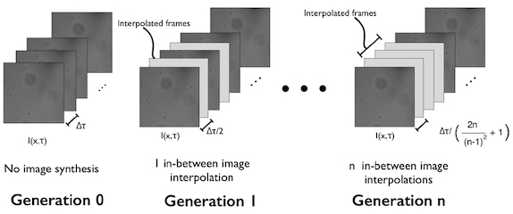
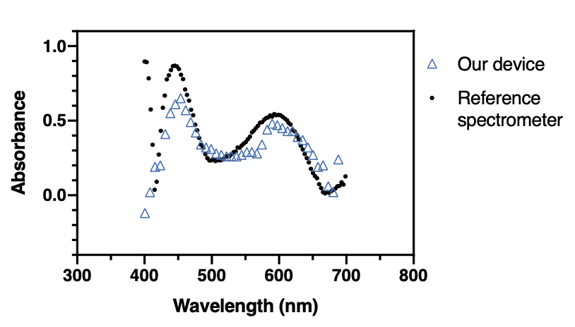

[Home](./) | [Research](./research.html) | [Collaborations](./collaboration.html)

  

    
  

  

    <h3>Smartphone-Based Platform for Micro- and Nanoparticle Sizing</h3>
    
<em>Keywords: Nanoparticle Sizing • Differential Dynamic Microscopy • Point-of-Care Diagnostics</em>

    
Micro- and nanoparticle sizing plays a vital role in fields such as medical diagnostics, environmental monitoring, and nanomaterial synthesis. Conventional differential dynamic microscopy (DDM) systems remain bulky, expensive, and unable to resolve multi-modal size distributions. We developed a compact, low-cost smartphone-based DDM platform utilizing a reversed lens and 3D-printed housing to create a portable microscope for non-destructive, label-free particle sizing. Coupled with non-negative least squares algorithms, the system accurately measures particles down to <strong>30 nm</strong> from a 10 µL sample within 4 minutes.

    
<strong>Related Publication:</strong> 
    <strong>Jarujareet, U.</strong>, & Koonyosying, P. (2026). A smartphone platform for portable and cost-effective micro- and nanoparticle sizing. <em>Sensors and Actuators A: Physical</em>, 117372. <a href="https://doi.org/10.1016/j.sna.2025.117372" target="_blank">DOI: 10.1016/j.sna.2025.117372</a>

  

---

  

    
  

  

    <h3>Beta-Thalassemia Variant Classification via Deep Learning</h3>
    
<em>Keywords: Deep Learning • Medical Imaging • Hematology • Thalassemia</em>

    
We introduced the <strong>Image Structure Function Image (ISFI)</strong> of whole blood as a novel spatial-temporal feature representation for blood disease characterization. By processing dynamic light fluctuations with deep learning architectures, this approach enables automated classification of severe thalassemia variants (including $\beta$-thalassemia major and $\text{HbE}/\beta$-thalassemia), supporting rapid diagnostic triage in clinical settings.

    
<strong>Related Publication:</strong> 
    <strong>Jarujareet, U.</strong>, Wiratchawa, K., Petiwathayakorn, T., Koonyosying, P., Hantrakool, S., Srichairatanakool, S., & Intharah, T. (2025). Classification of beta-thalassemia major and HbE/beta-thalassemia via deep learning of image structure function image. <em>Biomedical Signal Processing and Control</em>, 102, 107265. <a href="https://doi.org/10.1016/j.bspc.2024.107265" target="_blank">DOI: 10.1016/j.bspc.2024.107265</a>

  

---

  

    
  

  

    <h3>Portable Devices for Microrheological Characterization</h3>
    
<em>Keywords: Microrheology • Bio-fluid Dynamics • Hypercoagulability • Biomaterials</em>

    
We designed portable optical instrumentation to measure viscoelastic parameters (such as storage/loss modulus and shear viscosity) in micro-volume biological fluids. Applications include early detection of hypercoagulable states in transfusion-dependent patients and evaluating artificial saliva formulations for dentin remineralization.

    
<strong>Related Publications:</strong> 
    • Petiwathayakorn, T., et al. (2024). A Compact Differential Dynamic Microscopy-based Device (cDDM): An Approach Tool for Early Detection of Hypercoagulable State in Transfusion-Dependent-$\beta$-Thalassemia Patients. <em>ACS Applied Bio Materials</em>. <a href="https://doi.org/10.1021/acsabm.4c00516" target="_blank">DOI: 10.1021/acsabm.4c00516</a> 
    • Srisomboon, S., Intharah, T., <strong>Jarujareet, U.</strong>, et al. (2024). The in vitro assessment of rheological properties and dentin remineralization of saliva substitutes. <em>PLOS ONE</em>, 19(5), e0304156. <a href="https://doi.org/10.1371/journal.pone.0304156" target="_blank">DOI: 10.1371/journal.pone.0304156</a>

  

---

  

    
  

  

    <h3>DeepDDM: Deep Learning-Assisted Microrheology</h3>
    
<em>Keywords: DeepDDM • AI in Fluid Dynamics • Micro-rheology</em>

    
DeepDDM integrates convolutional neural networks into dynamic light scattering image processing, reducing micro-rheological assessment times for ultra-low volume samples ($< 10\ \mu\text{L}$) while providing real-time property extraction for bio-fluids and biomaterial characterization.

    
<strong>Related Publication:</strong> 
    <strong>Jarujareet, U.</strong>, Wiratchawa, K., Panpisut, P., & Intharah, T. (2023). DeepDDM: A Compact Deep-Learning Assisted Platform for Micro-Rheological Assessment of Micro-Volume Fluids. <em>IEEE Access</em>, 11, 68900-68910. <a href="https://doi.org/10.1109/ACCESS.2023.3290496" target="_blank">DOI: 10.1109/ACCESS.2023.3290496</a>

  

---

  

    
  

  

    <h3>Low-Cost Dual-Beam Smartphone Spectrometer</h3>
    
<em>Keywords: Optical Spectroscopy • Portable Instrumentation • Chemical Sensing</em>

    
Optical spectroscopy quantifies light absorption across visible wavelengths for biochemical sensing. By leveraging modern smartphone image sensors and a dual-beam optical design, we created a ultra-portable, low-cost spectrometer suitable for point-of-care diagnostics, agricultural analysis, and educational instrumentation.

    
<strong>Related Publication:</strong> 
    <strong>Jarujareet, U.</strong>, Pichayawaytin, G., et al. (2023). A Low-Cost Dual-Beam Smartphone Visible Spectrometer. <em>Journal of Chemical Education</em>, 100(2), 546–553. <a href="https://doi.org/10.1021/acs.jchemed.2c00642" target="_blank">DOI: 10.1021/acs.jchemed.2c00642</a>

  

